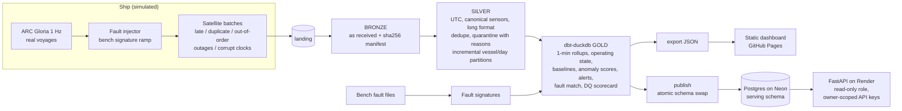

# Second Engineer

**A tireless second engineer for a ship's engine room.** It takes messy, satellite-delayed
machinery telemetry from different data loggers and turns it into one trusted model: clean,
deduplicated and quality-scored. It then learns what normal looks like per engine and flags
drift, names the likely fault and puts an (illustrative) off-hire cost on it.

Built on **real open ship data** (ARC Gloria, 1 Hz, Sep–Dec 2025) and a **real marine-diesel
fault dataset** (test bench). It is a demonstration, not a validated product: see
[Honest scope](#honest-scope).

- **Live dashboard:** https://vinaayakmanjunath.github.io/second-engineer/
- **Live API (Swagger):** https://second-engineer-api.onrender.com/docs (owner API keys required; free plan, so the first request after 15 min idle takes about a minute)
- **Results:** [docs/results.md](docs/results.md) · [docs/sensitivity.md](docs/sensitivity.md) · [docs/benchmarks.md](docs/benchmarks.md) · [docs/data_profile.md](docs/data_profile.md)
- **Design decisions:** [docs/decisions.md](docs/decisions.md) · **Scaling to a real fleet:** [docs/scaling.md](docs/scaling.md)



## What it does

| Step | What happens | Where |
|---|---|---|
| Download | Both Zenodo datasets, md5-verified, idempotent | `download.py` |
| Virtual fleet | One real ship split by voyage legs into GLORIA-A/B/C, shifted to a common replay date | `fleet.py`, `config/settings.yaml` |
| Vessel sensor assignment | Three loggers (Gloria local-time metric, a simulated UTC/psi/°F vendor logger, the test bench) map to one canonical registry with unit conversion | `config/sensors.yaml` |
| Fault injection | Air-cooler-fouling signature from the bench, ramped into GLORIA-C's main engine over 96 h; ground truth kept apart from the pipeline | `signatures.py`, `inject.py` |
| Ship-to-shore | Seeded satellite batches with identical re-sends, re-sends with new envelopes, late batches, outages and catch-up bursts, shuffled rows, blank and future timestamps | `simulator.py` |
| Bronze | Raw files as received, sha256 manifest; re-runs change nothing | `bronze.py` |
| Silver | Parse, map, convert the ship clock to UTC, quarantine with a reason, dedupe on (vessel, sensor, ts), rewrite only touched vessel-day partitions atomically | `silver.py` |
| Gold (dbt) | Incremental 1-min rollups, running state, speed-conditioned baselines, robust z, health index, alerts, fault match, DQ scorecard, illustrative $ at risk; schema, singular and reconciliation tests | `dbt/` |
| Evaluate | Fault vs no-fault control, false alerts, transport mess injected vs handled | `evaluate.py` |
| Publish | The tables the API serves are copied from DuckDB into Postgres (`serving` schema) and swapped in atomically; a failed load never touches what the API reads | `publish.py`, `deploy/neon_roles.sql` |
| Serve | Static dashboard with a replay slider; FastAPI on a read-only Postgres role, where each owner sees only their vessels | `site/`, `api.py`, `render.yaml` |

## Results (from generated docs)

**Data reliability** ([results.md](docs/results.md)). For every vessel, the simulator's injected
problems reconcile exactly with what the pipeline caught. Identical re-sends were dropped at bronze
(24 / 9 / 22) and re-sends with a new envelope at silver (23 / 11 / 15). Every blank and future
timestamp was quarantined, and **valid + quarantined readings = readings sent** (34,354,734 /
19,326,897 / 28,516,155).

**Detection, compared with a no-fault control** ([results.md](docs/results.md), [sensitivity.md](docs/sensitivity.md)).
The same vessel is re-run without the fault. Over the 96 h ramp at 3× bench severity, flagged
hours are **38 vs 17** in the control, peak |z| is **15.15 vs 6.84**, and the strongest alert's
top match is the injected fault (air-cooler fouling), against turbine degradation in the control.
Hour by hour, **22 hours are flagged only with the fault and 1 only in the control**; even at 1×
bench severity it is 19 vs 1. **No lead time is claimed:** this ship's exhaust temperatures drift
naturally, the control flags 32% of healthy hours before the ramp, and it also opens alerts in the
window. Flagged hours rise with severity (17 / 35 / 37 / 38 / 41 at 0× / 1× / 2× / 3× / 5×).
Transport noise is seeded per vessel, so the control is exactly paired with the full run.

**False alerts** on data with no fault: 0.25 / 0.077 / 0.333 per running day (GLORIA-A / B / C;
C is counted on its no-fault control, where every alert is false).

**Pipeline performance** ([benchmarks.md](docs/benchmarks.md), Apple M1 Pro laptop). The bronze → silver → gold build takes 79.4 s, with silver parsing 82,179,168 readings at about 1.19 M readings/s
(peak memory 4.6 GiB). When one batch arrives late, silver rewrites
**1 vessel-day partition** in 0.05 s, against 69.0 s for the full silver build. Re-running with nothing new processes 0 files, leaves the partition files untouched
and gives **identical gold checksums**. Silver Parquet is **3.9× smaller** than the raw CSV
(209.4 MB vs 811.1 MB). A week of hourly data takes 2.4 ms from the 1-minute rollup, against
11.6 ms from raw silver.

## Quickstart

Requires Python 3.11 and [uv](https://docs.astral.sh/uv/). About 120 MB is downloaded; a full
run takes a few minutes on a laptop.

```bash
make setup        # uv sync --frozen
make run          # download, simulate, bronze, silver, dbt gold + tests, evaluate (with control), export
make site-serve   # dashboard on http://localhost:8080
make test lint    # pytest + ruff
make bench sensitivity profile   # regenerate docs/benchmarks.md, docs/sensitivity.md, docs/data_profile.md
```

The API reads Postgres. With any Postgres you control (roles from `deploy/neon_roles.sql`):

```bash
PUBLISH_DATABASE_URL=postgresql://loader@localhost/db uv run secondeng publish
DATABASE_URL=postgresql://api_reader@localhost/db \
  API_KEYS='{"demo-north":"owner_north","demo-south":"owner_south"}' make api   # http://localhost:8000/docs
```

Every step is also a subcommand: `uv run secondeng --help`.

## Honest scope

- **Virtual vessels:** GLORIA-A/B/C are contiguous voyage legs of one real ship, shifted in time.
  GLORIA-B's second logger is simulated (same data, renamed tags, imperial units, UTC clock).
- **Injected fault:** the fault comes from a different, 3-cylinder test-bench engine. Its direction
  is measured on the bench; its size at failure (3× bench) is an assumption, swept in
  `sensitivity.md`. The detector is **demonstrated, not validated**.
- **Simple model on purpose:** a straight line against engine speed plus a robust sigma, so every
  alert can be explained. It still raises false alerts on healthy data. Context features (sea
  state, draft, sea temperature) are the next step.
- **$ at risk is illustrative:** an assumed off-hire event cost (off-hire, OPEX and bunkers for the
  off-hire days; see `config/settings.yaml`) × a severity weight. It is not a pricing model.

## Data

Data: *Sensor-Based Operational Dataset of Main Ship Machinery (ARC Gloria)*, Zenodo,
DOI [10.5281/zenodo.18330661](https://doi.org/10.5281/zenodo.18330661), CC BY 4.0. *Marine Engine
Fault* dataset, Zenodo, DOI [10.5281/zenodo.19857425](https://doi.org/10.5281/zenodo.19857425),
CC BY 4.0. Data transformed (resampled, mapped, fault-injected) for demonstration. Data is
downloaded at run time and not stored in this repo; see [DATA_LICENSES.md](DATA_LICENSES.md).

## Stack

Python 3.11 · Polars · pydantic · DuckDB · Parquet · dbt-duckdb · FastAPI · pytest · ruff · uv ·
Docker · GitHub Actions · GitHub Pages · Observable Plot

Code: MIT ([LICENSE](LICENSE)).

**How it was built.** One framework from planning to deployment: a written spec and plan, the build,
then CI and deployment. A human stayed in the loop to catch design and architecture faults; two
examples:
- replacing coarse load-band baselines with a speed-conditioned model;
- adding the no-fault control that changed what the results claim.

AI coding agents wrote much of the code. The commit history replays the build as reviewable phases
(committed at the end; each phase passes lint and its own tests). Core modules (settings, mapping,
simulator, injection, bronze/silver, evaluation helpers, API tenancy) have pytest unit tests; the
gold layer has dbt schema, reconciliation and fault-match tests; evaluate and export are exercised
by the full pipeline run in CI. After a review by independent AI review agents, the ingestion hardening (bad files,
crash safety, clock problems, strict config) was done test-first: each test failed before its fix.
Every number shown is produced by the pipeline.
